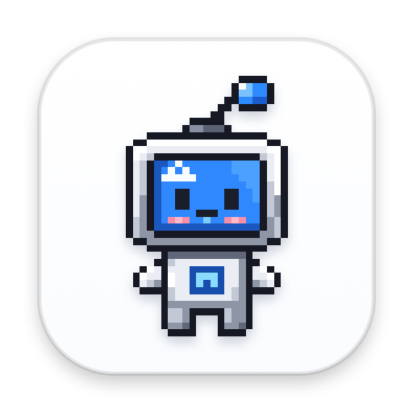
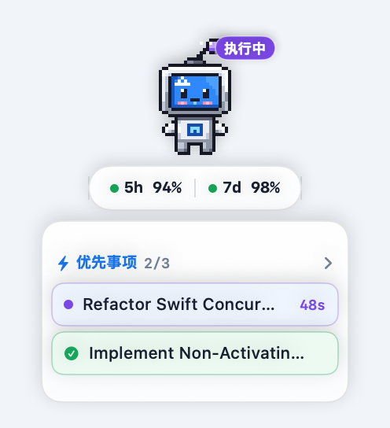
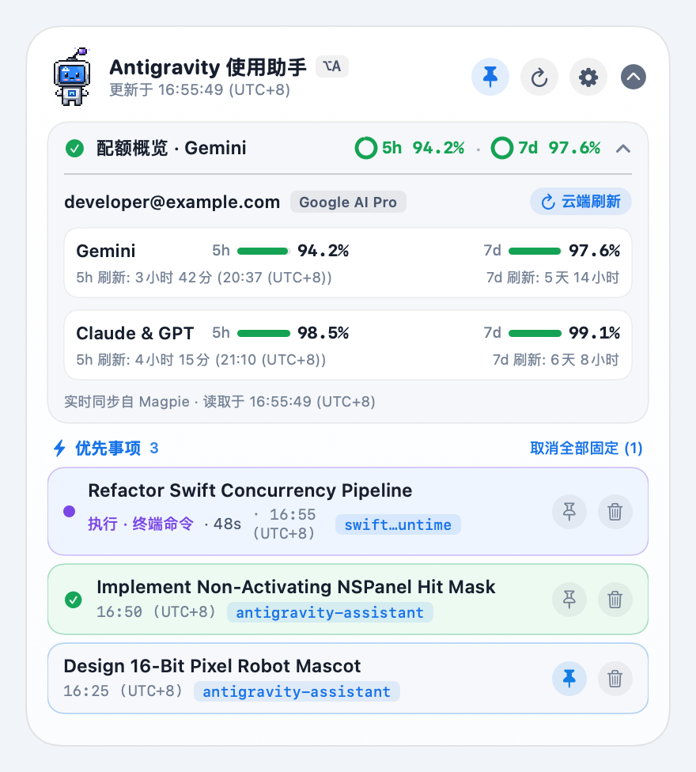
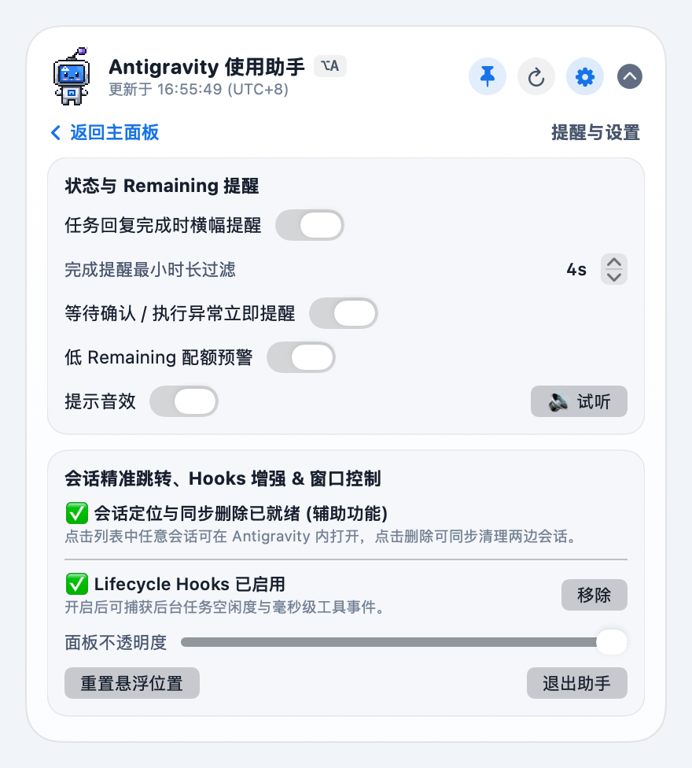

#  Antigravity Assistant

#### Choose Your Language: [简体中文](./README.md) | English

**A native macOS floating pixel-robot companion, real-time AI model quota watcher (`5h` & `7d`), and multi-session manager built for Google Antigravity.**

Built natively with `SwiftUI + AppKit` (zero Electron overhead, `< 0.1%` idle CPU), living unobtrusively on your macOS desktop and menu bar.

## Demo

<table>
  <tr>
    <td align="center">
      <strong>Floating Desktop Mascot</strong><br><br>
      
    </td>
    <td align="center">
      <strong>Quota & Sessions Dashboard</strong><br><br>
      
    </td>
    <td align="center">
      <strong>Alerts & Settings <a href="./CONFIG.en.md">(Docs)</a></strong><br><br>
      
    </td>
  </tr>
</table>

## System Requirements


## Installation

### Option 1: Prebuilt Release (Recommended)

1. Download the latest `AntigravityAssistant-macos-arm64.zip` from [Releases](https://github.com/superhei97/AntigravityAssistant/releases/latest).
2. Extract and move `AntigravityAssistant.app` into `/Applications`, then launch it.

> [!NOTE]
> Since the bundle is ad-hoc signed, if macOS Gatekeeper blocks the first launch, clear the quarantine attribute once in Terminal:
> ```bash
> xattr -cr /Applications/AntigravityAssistant.app
> open /Applications/AntigravityAssistant.app
> ```

### Option 2: Build from Source

Requires Xcode Command Line Tools (`xcode-select --install`):

```bash
git clone https://github.com/superhei97/AntigravityAssistant.git
cd AntigravityAssistant
./scripts/build_app.sh
open ./dist/AntigravityAssistant.app
```

## Key Features

- **16-Bit Pixel Robot Mascot + Menu Bar Live Readout**:
  - Hand-crafted pixel-art Antigravity CRT mascot whose antenna orb and facial expressions react to live agent states (`Idle`, `Thinking`, `Running Tool`, `Waiting Confirmation`, `Error`).
  - **Window-Server Click-Through & Non-Activating Panel**: Only clicking the robot icon expands the full dashboard. Surrounding blank areas pass mouse clicks `100%` straight through to underlying windows (e.g., Chrome or your IDE) without stealing focus.
  - **Multi-Monitor & All-Spaces Dragging**: Drag seamlessly across vertically or horizontally stacked displays and macOS Spaces.
- **Real-Time `5h` & `7d` Quota Tracking**:
  - Automatically queries local [Magpie](https://github.com/raghavpillai/magpie) quota gateway (`127.0.0.1:3425` or CLI) for exact **Gemini** and **Claude & GPT** `5h` / `7d` remaining percentages and reset countdowns.
  - Gracefully falls back to local transcript bucket estimation + one-click clipboard sync when Magpie is not installed.
- **Smart `⚡ Priority` Queue**:
  - Folded by default underneath the desktop mascot to show **only actively running and unread newly-completed tasks**; click the `Priority` header bar to unfold pinned (`📌`) sessions.
  - Unpinned tasks that finish running stay in `Priority` until you click to inspect them, then automatically move to `Today / Yesterday / Weekday` groups.
- **Workspace Project Badges, One-Click Jump & Dual-Side Delete**:
  - Automatically extracts project names from Antigravity's local `conversation_summaries.db` (falling back to `default`), detects user cancellations immediately, jumps directly to any conversation via macOS Accessibility, and supports 2-tap synchronized deletion.

## Configuration

See **[📖 Configuration Guide](./CONFIG.en.md)** for Accessibility permissions, quota synchronization, Lifecycle Hooks, and hotkeys.

## Credits

- Inspired by [wusimpl/AntigravityQuotaWatcher](https://github.com/wusimpl/AntigravityQuotaWatcher)

## License

[MIT License](./LICENSE)
