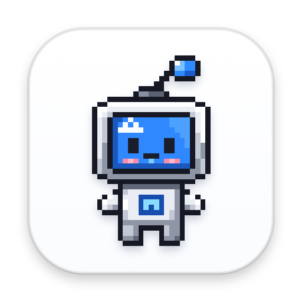
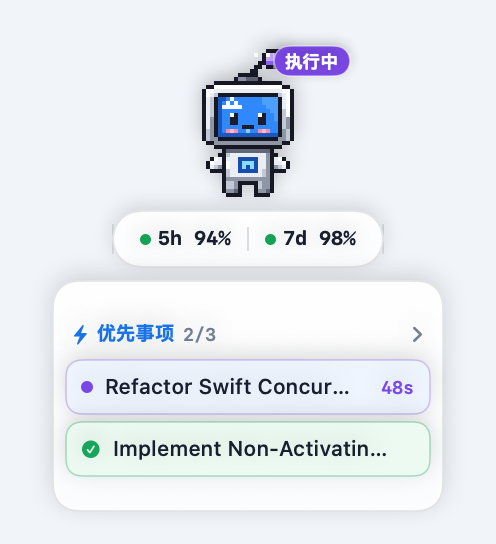
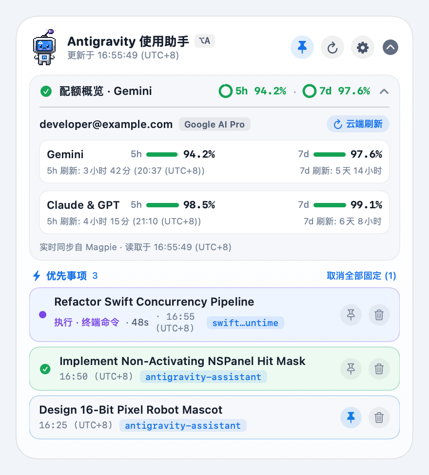
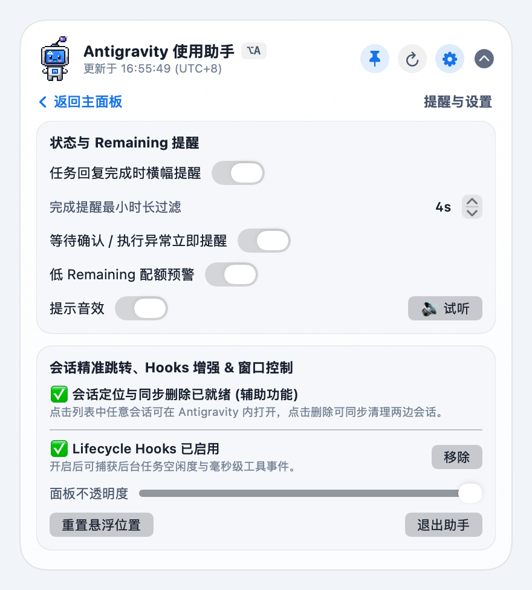

#  Antigravity Assistant

#### Choose Your Language: 简体中文 | [English](./README.en.md)

**一个专为 Google Antigravity 打造的 macOS & Windows 双平台原生桌面悬浮机器人与实时 AI 配额 / 多会话管理助手。**

- **macOS 原生版**：基于 `SwiftUI + AppKit` 构建，常驻桌面与顶部菜单栏。
- **Windows 原生版**：基于 `WPF + Win32 + UI Automation + winsqlite3.dll` 构建，零额外运行时依赖（单文件 `< 300 KB`），常驻桌面与系统托盘。

彻底告别臃肿的 Electron 架构，内存与 CPU 占用极低，实时显示 **Gemini / Claude & GPT 5h · 7d 剩余配额**、追踪多并行会话执行进度，并支持一键精准定位与双向清理会话。

## 演示

<table>
  <tr>
    <td align="center">
      <strong>桌面悬浮小机器人</strong><br><br>
      
    </td>
    <td align="center">
      <strong>配额与多会话面板</strong><br><br>
      
    </td>
    <td align="center">
      <strong>提醒与设置 <a href="./CONFIG.md">(配置文档)</a></strong><br><br>
      
    </td>
  </tr>
</table>

## 系统要求


-0078D4?logo=windows&logoColor=white)


-512BD4?logo=dotnet&logoColor=white)


## 安装方法

### 方式一：下载安装包直接运行（推荐）

#### Windows (10 / 11 x64)
1. 前往 [Releases 页面](https://github.com/superhei97/AntigravityAssistant/releases/latest) 下载最新的 `AntigravityAssistant-windows-x64.zip`（或直接从源码一键编译）。
2. 解压后双击运行 `AntigravityAssistant.exe` 即可（使用系统内置框架，无需安装任何额外 SDK 或运行时）。

#### macOS (14.0+)
1. 前往 [Releases 页面](https://github.com/superhei97/AntigravityAssistant/releases/latest) 下载最新的 `AntigravityAssistant-macos-arm64.zip`。
2. 解压后将 `AntigravityAssistant.app` 拖入 `/Applications`（应用程序）文件夹并双击启动。

> [!NOTE]
> macOS 下由于未绑定付费 Apple Developer 证书，首次打开如提示「无法验证开发者」，请在终端执行以下命令清除隔离属性后再打开：
> ```bash
> xattr -cr /Applications/AntigravityAssistant.app
> open /Applications/AntigravityAssistant.app
> ```

### 方式二：源码一键编译

#### Windows 源码编译（零外部编译依赖）
直接调用 Windows 10/11 系统自带的 64 位 `.NET Framework` 编译器（`csc.exe`），无需安装 Visual Studio 或额外 SDK，数秒内即可生成单文件原生 `AntigravityAssistant.exe`：

```powershell
git clone https://github.com/superhei97/AntigravityAssistant.git
cd AntigravityAssistant
.\scripts\build_windows.ps1
.\dist\AntigravityAssistant.exe
```

#### macOS 源码编译
确保系统已安装 Xcode Command Line Tools（`xcode-select --install`），执行构建脚本即可生成 `.app` 应用包：

```bash
git clone https://github.com/superhei97/AntigravityAssistant.git
cd AntigravityAssistant
./scripts/build_app.sh
open ./dist/AntigravityAssistant.app
```

## 功能特点

- **像素风桌面悬浮机器人 + 菜单栏 / 系统托盘双形态**：
  - 16-bit 像素风 Antigravity CRT 机器人，天线能量球与表情随会话状态（待命 / 思考中 / 执行工具 / 待确认 / 异常）实时动态变化。
  - **严格防误触与空白穿透**：仅点击机器人图标才展开详情面板；机器人与配额胶囊周围空白区域在系统窗口层（macOS `ignoresMouseEvents` / Windows `WS_EX_TRANSPARENT | WS_EX_NOACTIVATE`）`100%` 鼠标穿透，不拦截底层浏览器或编辑器点击，不抢夺输入焦点。
  - **跨显示器 / HiDPI 无缝拖动**：支持多屏拼接与 Windows `PerMonitorV2` 缩放无缝拖拽，macOS 自动跟随所有 Spaces。
- **5h / 7d 实时配额监控与低配额预警**：
  - **Windows 内置 Magpie 同源 Google 实盘配额直连**：无需安装或配置额外网关，点击面板内「🌐 Google 登录直连实盘配额」（或粘贴导入 `1//` Refresh Token / JSON 账号），即可通过 Google Code Assist 官方接口实时读取 **Gemini** 与 **Claude & GPT** 模型池的 `5h` 与 `7d` 精确剩余百分比及 `UTC+8` 刷新倒计时（Refresh Token 经 Windows DPAPI 本机加密存储）。
  - 同时兼容自动连接本机 [Magpie](https://github.com/yetone/magpie) 配额网关（`127.0.0.1:3425` 或 CLI）；未登录云端时支持从剪贴板一键同步官方 Usage 文字锚点。
- **智能「⚡ 优先事项」队列**：
  - 桌面挂件默认折叠 `优先事项`，仅展示**正在运行中**与**刚完成待查看**的任务；点击 `优先事项` 标题栏可展开查看全部已固定（`📌`）会话。
  - 未固定的任务在运行完成后会自动保留在 `优先事项`（带绿色完成标记），直到你点击定位查看后才自动移出并归入 `今天 / 昨天 / 星期xx` 分组。
- **项目归属识别 + 一键直达与双向同步删除**：
  - 只读解析 `conversation_summaries.db`（Windows 调用系统原生 `winsqlite3.dll`）提取工作区项目名（无工作区显示 `default`），识别用户主动中断状态（`User cancelled`）并即时回填。
  - 点击任意会话即可唤醒 `Antigravity` 并精准跳转到对应会话（macOS 基于 `AXUIElement`，Windows 基于原生 `UI Automation` + `Ctrl+K` 兜底）；支持二次确认同步删除侧边栏与本地记录（安全移入废纸篓 / 回收站）。
- **任务完成与待确认原生横幅提醒**：
  - 长耗时任务完成、Agent 发起提问确认（`ask_question`）或异常中断时发送系统原生通知与提示音，点击通知直接跳转到对应会话。

## 快捷交互一览

| 操作位置 | 行为说明 |
| :--- | :--- |
| **点击像素机器人本体** | 展开 / 收起完整配额与会话面板 |
| **点击展开面板顶部空白处** | 收起回桌面悬浮小机器人 |
| **点击 `⚡ 优先事项` 标题栏** | 折叠（仅显示运行中 + 未读完成）/ 展开全部固定会话 |
| **点击任意会话行** | 唤醒 `Antigravity` 跳转到该会话（未读完成项同时移出优先事项） |
| **按住机器人 / 胶囊 / 标题栏拖动** | 跨屏幕自由移动悬浮窗并自动记忆位置 |
| **全局快捷键 `⌥ + A` (macOS) / `Alt + A` (Windows)** | 随时一键隐藏 / 呼出桌面悬浮窗 |
| **右键系统托盘 (Win) / 点击顶部菜单栏 (macOS)** | 查看实时配额摘要、同步剪贴板 Usage、切换开机自启或退出 |

## 配置选项

详细权限说明、配额同步方式及可选 Lifecycle Hooks 插件配置请查看：**[📖 配置文档](./CONFIG.md)**

## 提交 Issue

<details>
<summary>点击展开排错与自检说明</summary>

提交 Issue 时可附上终端自检输出（请自行脱敏邮箱或私有项目名）：

**Windows (PowerShell)：**
```powershell
.\dist\AntigravityAssistant.exe --self-test
```

**macOS (Terminal)：**
```bash
/Applications/AntigravityAssistant.app/Contents/MacOS/AntigravityAssistant --self-test
```

- **macOS 辅助功能提示**：若重编译覆盖安装后遇到无法自动跳转会话，请前往 **系统设置 → 隐私与安全性 → 辅助功能**，将旧的 `Antigravity 使用助手` 移除后重新添加勾选即可（macOS TCC 对重签名二进制的安全校验机制）。
- **Windows 权限提示**：Windows 原生 `UI Automation` 默认即用，无需额外系统隐私授权；若 `Antigravity.exe` 以管理员身份运行，建议同样以管理员权限启动 `AntigravityAssistant.exe` 以确保跨进程 UIPI 窗口跳转正常生效。

</details>

## 致谢与参考

- 灵感与文档结构参考自 [wusimpl/AntigravityQuotaWatcher](https://github.com/wusimpl/AntigravityQuotaWatcher)

## License

[MIT License](./LICENSE)
